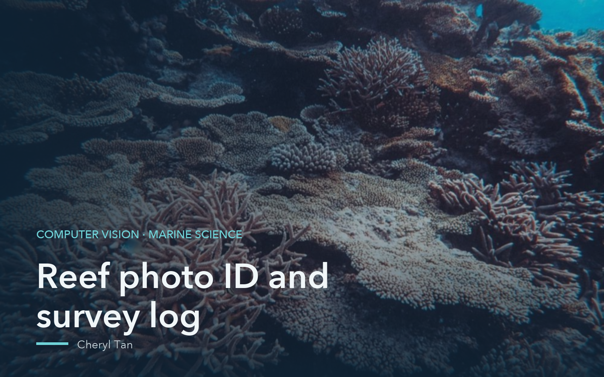

# 🪸 Reef ID App



Coral reef photo classifier and survey logger: upload a dive photo, get **CORAL** (healthy) vs **CORAL_BL** (bleached) from the [NOAA ESD ViT classifier](https://huggingface.co/NMFS-OSI/noaa-esd-coral-bleaching-vit-classifier-v1), and log predictions with optional latitude/longitude to a CSV.

**Stack:** Streamlit, Hugging Face Transformers, Pandas. Deploy on **Hugging Face Spaces** (recommended: free, persistent storage, auto-deploy from GitHub).

---

## Quick start (local)

1. **Clone** (after creating the repo on GitHub):
   ```bash
   git clone https://github.com/yourusername/reef-id-app.git
   cd reef-id-app
   ```

2. **Optional – CPU-only PyTorch** (smaller install, fine for free tier):
   ```bash
   pip install torch torchvision torchaudio --index-url https://download.pytorch.org/whl/cpu
   ```

3. **Install dependencies and run:**
   ```bash
   pip install -r requirements.txt
   streamlit run app.py
   ```

4. Open the app, upload a reef image (e.g. from [Kaggle coral datasets](https://www.kaggle.com/datasets)), enter lat/lon, click **Identify Coral**. Predictions are appended to `reef_surveys.csv` in the repo root.

---

## Deploy on Hugging Face Spaces

1. Create a **public** repo named `reef-id-app` on GitHub and push this code (including `app.py`, `requirements.txt`, `README.md`).
2. Log in at [huggingface.co](https://huggingface.co) → **New Space** → **From GitHub repo** → select `reef-id-app`.
3. **SDK:** Streamlit → **Create**. The Space will build and run `streamlit run app.py`.
4. In Space **Settings**, request **persistent storage** (free tier starts at 5GB). To persist the survey CSV across restarts, set the env var `HF_HOME` or save `reef_surveys.csv` to the path shown in your Space’s “Storage” docs (e.g. a mounted volume); otherwise the CSV lives in the container and is reset on redeploy.

App URL: `https://huggingface.co/spaces/yourusername/reef-id-app`.

---

## Project layout

```
reef-id-app/
├── app.py             # Main Streamlit app
├── requirements.txt   # Dependencies
├── reef_surveys.csv   # Created on first prediction (git add/commit to persist)
└── README.md
```

---

## Model upgrade path

- **Current:** [NMFS-OSI/noaa-esd-coral-bleaching-vit-classifier-v1](https://huggingface.co/NMFS-OSI/noaa-esd-coral-bleaching-vit-classifier-v1) — health/bleaching (CORAL vs CORAL_BL).
- **Segmentation:** [reefsupport/CoralSCOP](https://huggingface.co/reefsupport/CoralSCOP) — swap to a segmentation pipeline if you need masks.
- **Fine-tuning:** Use [Coralscapes](https://huggingface.co/datasets/EPFL-ECEO/coralscapes) (e.g. on Colab), then push a custom model to HF and point the app at it.

---

## Optional: Git LFS for images

If you store sample images in the repo:

```bash
git lfs track "*.png"
git add .gitattributes
```

---

## Links

- [Hugging Face Spaces storage](https://huggingface.co/docs/hub/en/spaces-storage)
- [NOAA ESD Coral Bleaching ViT Classifier](https://huggingface.co/NMFS-OSI/noaa-esd-coral-bleaching-vit-classifier-v1)
